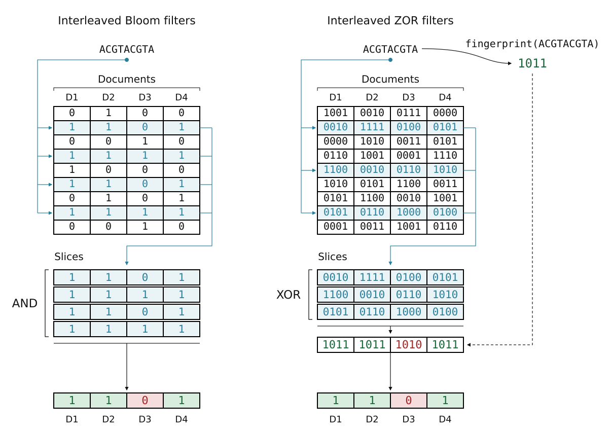

# Zindex

[Zindex](https://www.biorxiv.org/content/10.64898/2026.11.05.764633v1) is a resource-efficient approximate index for searching sequence
collections, in the same family as [Raptor](https://github.com/seqan/raptor),
[COBS](https://github.com/bingmann/cobs) and
[kmindex](https://github.com/tlemane/kmindex). It reports the number of query
seed matches in each indexed dataset.

Zindex uses interleaved [ZOR filters](https://doi.org/10.4230/LIPIcs.SEA.2026.24)
for SIMD queries and plans its layout with sketches adapted from Ragnar Groot
Koerkamp's [SimdSketch](https://github.com/RagnarGrootKoerkamp/simd-sketch).
Seed extraction includes the
[open-closed mod-minimizer algorithm](https://doi.org/10.1186/s13015-025-00270-0)
by Ragnar Groot Koerkamp et al. FASTA/FASTQ parsing uses
[Helicase](https://doi.org/10.64898/2026.03.19.712912) by Igor Martayan et al.



[KmerIndexBenchmark](https://github.com/Malfoy/KmerIndexBenchmark) provides the
dataset accessions used in the [paper](https://www.biorxiv.org/content/10.64898/2026.11.05.764633v1)
and a benchmark suite for comparing sequence collection indexes.

## Install and test

```bash
git clone https://github.com/Malfoy/Zindex.git
cd Zindex
cargo build --release --locked
```

Check the installation on the ten bundled bacterial genomes:

```bash
bash utils/scripts/demo.sh
```

## Build and query

[Ten bacterial genomes](tests/data/bacteria/), compressed as FASTA.gz, are
bundled with queries. Run these examples from the repository root.

Index every 31-mer (the default):

```bash
./target/release/zorindex build --fof tests/data/bacteria/samples.fof \
  --output bacteria.zindex --threads 4
```

Query a 1-kbp fragment from the first genome:

```bash
./target/release/zorindex query --index bacteria.zindex \
  --query tests/data/bacteria/query.fa
```

The first dataset rows are:

```text
color              matches  ratio       unique_kmers
GCF_000006885.1     970      1.00000000  2061304
GCF_000008805.1     0        0.00000000  2088293
GCF_000007525.1     2        0.00206186  2219976
```

The source genome matches all 970 query 31-mers. `matches` is the count over the
query file, `ratio` is its matching fraction, and `unique_kmers` counts distinct
indexed seeds in each dataset.

## Build options

### Mandatory

| Short | Option | Default | Meaning |
|---|---|---|---|
| `-f` | `--fof` | Required | File listing one FASTA/FASTQ path per dataset, optionally preceded by a name and a tab |

Relative input paths use the working directory. Gzip, zstd, xz and bzip2 inputs
are supported. Dense k-mers accept any positive `k`.

### Important

| Short | Option | Default | Meaning |
|---|---|---|---|
| `-k` | `--k` | `31` | K-mer length, or window length in bases when indexing minimizers |
| `-o` | `--output` | `myindex-DATE-TIME` | New index directory, automatically named with a UTC timestamp |
| `-t` | `--threads` | Available CPU threads | Worker count for construction, queries and fusion |
| `-H` | `--hashes` | `4` | Number of cell locations read and XORed per filter, from 2 to 32 |
| `-b` | `--fingerprint-bits` | `8` | Fingerprint width, one of 1, 2, 4, 8, 16 or 32 bits |
| `-i` | `--index-mode` | `kmers` | `kmers`, `minimizers`, `modimizers` or `findere` |
| `-m` | `--minimizer-size` | Required in minimizer mode | Length of each selected minimizer, from 1 to 31 bases |
| `-X` | `--max-subindex-size` | `8GiB` | Maximum resident filter payload during default queries, a power of two in bytes or KiB/MiB/GiB |

By default, queries load one subindex at a time, so `--max-subindex-size` bounds
resident filter data. Query features, results, recovery data and decompression
buffers require additional RAM. `--query-memory all` loads all subindexes together.

More hash functions can make the index smaller, but slow queries.
Wider fingerprints reduce accidental matches at a space cost, with fingerprint
collision probability approximately `2^-b` for `b` bits.

For 16-bit fingerprints and three hash locations:

```bash
./target/release/zorindex build --fof tests/data/bacteria/samples.fof \
  --output bacteria.fp16.zindex --k 31 --fingerprint-bits 16 --hashes 3
```

### Minimizers

Minimizer mode selects an `m`-base representative from each `k`-base window.
Overlapping windows often select the same representative, reducing the number
of seeds to store and query. **`k` is the window length and `m` is the
minimizer size.**

Index 31-base minimizers from 49-base windows:

```bash
./target/release/zorindex build --fof tests/data/bacteria/samples.fof \
  --output bacteria.min.zindex --index-mode minimizers --k 49 --minimizer-size 31
```

Exact `k`-mer matches are preserved because the same window selects the same
minimizer during construction and querying. An absent `k`-mer can still match
if its minimizer occurs elsewhere in the dataset.

A window contains `k - m + 1` possible minimizers. For random minimizers, use
`2 / (k - m + 2)` as a pessimistic density estimate, giving approximately
`(k - m + 2) / 2` times fewer selected positions. Open-closed mod-minimizers
generally achieve lower density.

| Window length `k` | Minimizer size `m` | Estimated selected fraction | Seed reduction |
|---|---|---|---|
| 39 | 31 | 20% | 5× |
| 49 | 31 | 10% | 10× |
| 69 | 31 | 5% | 20× |

Minimizer mode requires an odd `k <= 255` and `1 <= m <= min(k, 31)`.
Larger windows reduce storage and query work while making the representative
less specific to its full window.

## Query options

### Mandatory

| Short | Option | Default | Meaning |
|---|---|---|---|
| `-i` | `--index` | Required | Index directory |
| `-q` | `--query` | Required | Query FASTA/FASTQ file |

### Important

| Short | Option | Default | Meaning |
|---|---|---|---|
| `-t` | `--threads` | Available CPU threads | Query workers |
| `-a` | `--min-ratio` | `0` | Minimum matching fraction, from 0 to 1 |
| `-r` | `--records` | `false` | Score each FASTA sequence or FASTQ read separately |

Without `--records`, counts are combined across the whole query file. With
`--records`, each sequence or read has its own results. Both modes support findere.

Report datasets matching at least 80% of each query's seeds:

```bash
./target/release/zorindex query --index bacteria.zindex \
  --query tests/data/bacteria/queries.fa --records --min-ratio 0.8 --threads 4
```

The bundled queries include a fragment from each genome, its reverse complement
and a negative control. The first two query records produce:

```text
query_id                    dataset_id  dataset_name     matches  queried_seeds  ratio
GCF_000006885.1_forward      0           GCF_000006885.1  970      970            1.00000000
GCF_000006885.1_reverse      0           GCF_000006885.1  970      970            1.00000000
```

`matches` counts matching seed occurrences, `queried_seeds` counts selected
query seeds, and `ratio` is their quotient. Dataset IDs follow input order.
A query with no match has one row with `.` in both dataset fields and zero
matches, including queries too short to yield seeds.

To query the minimizer index, change only the index path. Extraction settings
are read from the index:

```bash
./target/release/zorindex query --index bacteria.min.zindex \
  --query tests/data/bacteria/queries.fa --records --min-ratio 0.8
```

Inspect an index with:

```bash
./target/release/zorindex info --index bacteria.zindex
```

## Fuse existing indexes

Fusion combines existing compatible indexes without rereading their source
genomes. Build two indexes from five bacterial genomes each, then fuse them:

```bash
head -n 5 tests/data/bacteria/samples.fof > first.fof
tail -n 5 tests/data/bacteria/samples.fof > second.fof
./target/release/zorindex build -f first.fof -o first.zindex -k 31
./target/release/zorindex build -f second.fof -o second.zindex -k 31
./target/release/zorindex fusion -i first.zindex second.zindex -o combined.zindex
./target/release/zorindex query --index combined.zindex \
  --query tests/data/bacteria/queries.fa --records --min-ratio 0.8
```

| Short | Option | Default | Meaning |
|---|---|---|---|
| `-i` | `--index` | Required | At least two input index directories, in output dataset order |
| `-o` | `--output` | `myindex-DATE-TIME` | New fused directory outside all inputs |
| `-t` | `--threads` | Available CPU threads | Fusion workers |

Inputs must use identical seed extraction, hashing, fingerprint widths, segment
lengths and recovery settings. Their layout algorithms, capacities and partition
sizes may differ. Fusion preserves all datasets in input order, including duplicate
names, and a fused index can be fused again. It copies the existing filters, so
its size and query cost can differ from rebuilding the combined collection.

## Spaced seeds

A spaced seed retains positions marked `#` and skips positions marked `_`.
The pattern must be symmetric under reversal. Its width is `k` for dense
indexing and `m` for minimizers.

Example symmetric seeds following
[Zentgraf et al. (2025)](https://doi.org/10.4230/LIPIcs.WABI.2025.22):

| Retained bases | Copyable `--seed-pattern` value |
|---|---|
| 21 | `##_#_####_#_#_###_#_#_####_#_##` |
| 23 | `#####__###__#######__###__#####` |
| 25 | `######__####_#####_####__######` |

```bash
./target/release/zorindex build --fof tests/data/bacteria/samples.fof \
  --output bacteria.spaced.zindex --k 31 \
  --seed-pattern '##_#_####_#_#_###_#_#_####_#_##' --threads 4
```

## Randstrobemers

[Randstrobemers](https://doi.org/10.1101/gr.275648.121), introduced by Kristoffer
Sahlin, link separated sequence pieces to improve tolerance to indels.

```bash
./target/release/zorindex build --fof tests/data/bacteria/samples.fof \
  --output bacteria.strobe.zindex --k 21 --randstrobemers \
  --strobe-min 25 --strobe-max 100
```

In this example, `--k 21` sets the length of each strobe to 21 bases.
`--strobe-min 25` and `--strobe-max 100` place the second strobe's start
between 25 and 100 bases after the first strobe's start.

Zindex uses [strobealign's](https://doi.org/10.1186/s13059-022-02831-7)
partner-selection rule. Without sampling, each strobe has length `k`. With
minimizer sampling, it links selected seeds of length `m`. Distances are measured
between strobe starts and default to one to three times the strobe length.
Queries score both orientations and retain the larger count per dataset and
record.

## Advanced options

Advanced controls follow the mandatory and important options in `-ah` /
`--advanced-help`. Regular `-h` / `--help` shows the user options.

### Construction

| Short | Option | Default | Meaning |
|---|---|---|---|
| `-g` | `--max-ram-gb` | 80% of available RAM | Construction memory limit in decimal GB, used for admission and RSS checks |
| `-P` | `--merge-planner` | `streaming` | Layout algorithm, `streaming`, `full` for smaller collections, or `naive` for input-order placement |
| `-e` | `--build-storage` | `disk` | `disk` stages filters on disk, `cached` also caches seeds to avoid rereading inputs, or `memory` keeps completed filters in RAM without scratch files |
| `-D` | `--min-subindex-documents` | `128` | Minimum original datasets per size class, use 1 to retain small classes |
| `-N` | `--max-subindexes` | Unlimited | Size-class cap before hash partitioning, trades padding for fewer query probes |
| `-K` | `--merge-sketch-size` | `128` | Power-of-two sketch bucket count, from 64 to 1048576 |
| `-G` | `--merge-plan-margin` | `0.03` | Additional union-cardinality planning margin, from 0 inclusive to 0.5 exclusive |
| `-U` | `--merge-disabled` | `false` | Build singleton filters |
| `-s` | `--seed` | `69` | Unsigned 64-bit hash seed, stored for querying |
| `-S` | `--slot-scale` | `1` | Positive finite capacity multiplier before power-of-two rounding |
| `-L` | `--segment-length` | `64` | Power-of-two hash segment length, from 1 to 4096 cells |
| `-R` | `--drop-abandoned` | `false` | Omit recovery data, allowing present seeds to be missed |

Construction fails if a dataset cannot fit within the memory limit. The
subindex size cap controls filter payload and is separate from the RAM limit.
The naive planner ignores size-class promotion settings.

### Seed extraction

| Short | Option | Default | Meaning |
|---|---|---|---|
| `-M` | `--minimizer-scheme` | `open-closed-mod` | `open-closed-mod` or standard SIMD hash minimizers (`simd`) |
| `-p` | `--seed-pattern` | Unset | Symmetric `#`/`_` mask of width k, or m for minimizers, with at least one retained base |
| `-r` | `--randstrobemers` | `false` | Link two seeds, available for dense k-mers and minimizers |
| `-l` | `--strobe-min` | Strobe length | Positive minimum start distance, requires randstrobemers |
| `-u` | `--strobe-max` | 3 × strobe length | Maximum start distance, at least the minimum, requires randstrobemers |
| `-c` | `--homopolymer-compression` | `false` | Collapse repeated bases before extracting seeds |
| `-d` | `--modimizer-sampling` | `16` | Positive hash-sampling denominator for `--index-mode modimizers` |
| `-z` | `--findere-z` | `10` | In findere mode, index `(k-z)`-mers and require consecutive hits to reconstruct k-mer matches |

Masks are supported for dense k-mers and minimizers. Findere accepts any positive
`k`, with `--findere-z` smaller than `k`.
Modimizers accept any positive `k` and retain roughly one in `--modimizer-sampling`
canonical k-mers.

### Queries

| Short | Option | Default | Meaning |
|---|---|---|---|
| `-M` | `--query-memory` | `subindex` | Load one subindex at a time, or `all` to load them together |
| `-B` | `--record-batch-size` | `4096` | Positive record count per parallel reporting batch |
| `-F` | `--output-format` | `tsv` | With `--records`, named TSV rows or `compact` output |

Compact output contains `query_id`, `valid_kmers` and comma-separated
`dataset_id:matches` hits. `valid_kmers` is the selected seed count, and an empty
`hits` field means no match. TSV names containing delimiters or quotes use CSV
quoting. At threshold zero, all datasets are reported, including zero counts.

### Help and version

| Short | Option | Default | Meaning |
|---|---|---|---|
| `-h` | `--help` | — | Mandatory and important options for the selected command |
| `-ah` | `--advanced-help` | — | Include advanced controls and detailed help |
| `-V` | `--version` | — | Root command version |

Short flags are case-sensitive and apply within their subcommand. `info` accepts
`-i` / `--index` and the common thread and help options.

## Citation

Okçu et al. (2026). *Toward space-optimal approximate colored indexes at scale.*
[bioRxiv](https://www.biorxiv.org/content/10.64898/2026.11.05.764633v1) ·
[PDF](Zindex.pdf).

[MIT license](LICENSE).
