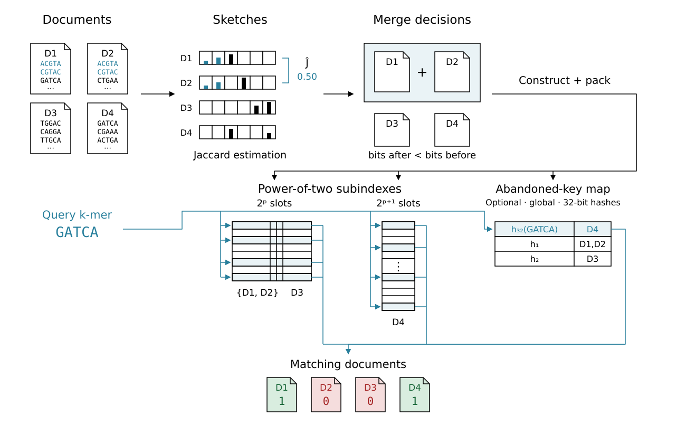
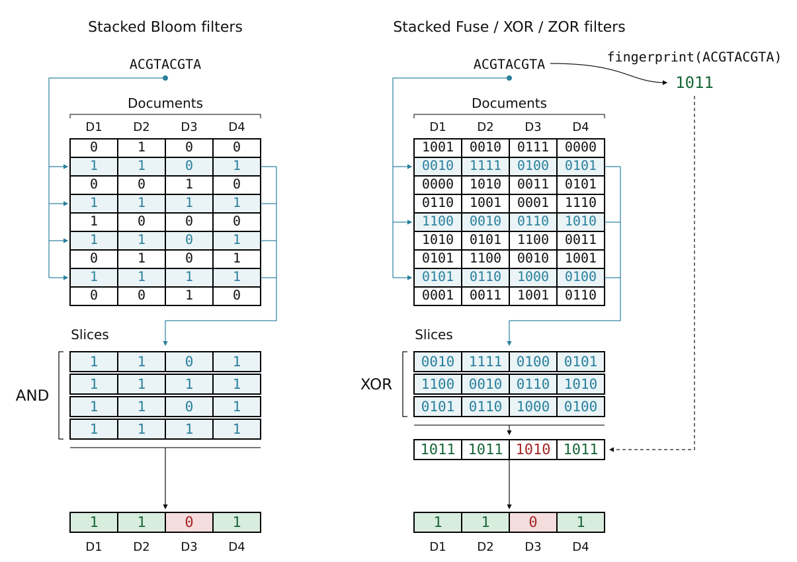
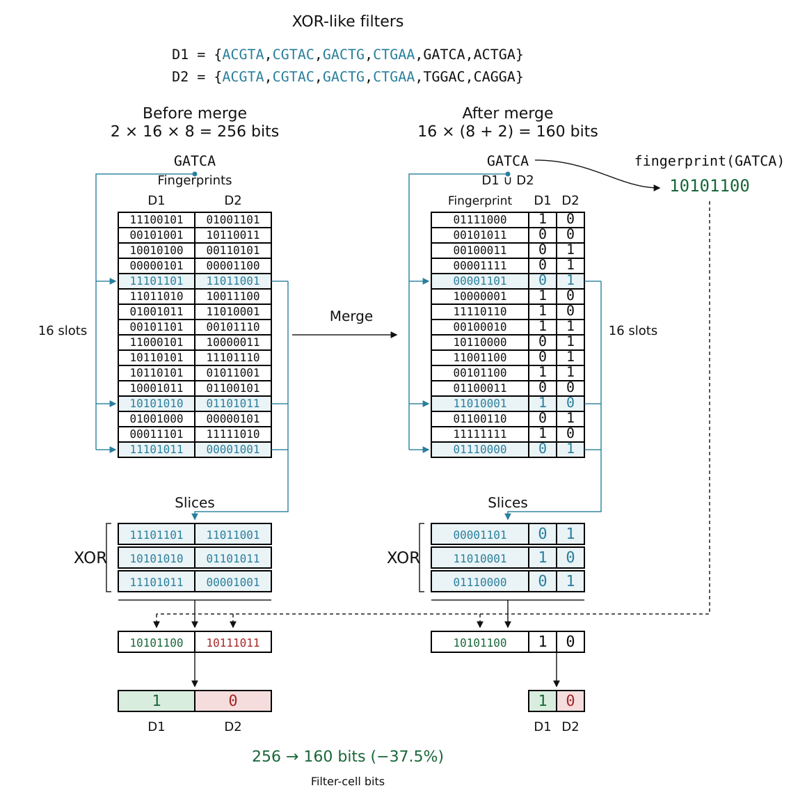

# Zindex

Zindex is a resource-efficient approximate index for searching sequence
collections, in the same family as [Raptor](https://github.com/seqan/raptor),
[COBS](https://github.com/bingmann/cobs) and
[kmindex](https://github.com/tlemane/kmindex). It reports the number of query
seed matches in each indexed dataset.

Zindex combines [ZOR filters](https://doi.org/10.4230/LIPIcs.SEA.2026.24) with
color-preserving merging, allowing similar datasets to share a filter while
retaining their individual membership. Merge planning uses Ragnar Groot
Koerkamp's [SimdSketch](https://github.com/RagnarGrootKoerkamp/simd-sketch),
adapted to sketch indexed seeds and merge their sketches. Filters are grouped
into power-of-two subindexes with interleaved cells for SIMD queries.
Seed extraction includes an optimized implementation of the
[open-closed mod-minimizer algorithm](https://doi.org/10.1186/s13015-025-00270-0)
by Ragnar Groot Koerkamp et al. FASTA/FASTQ parsing uses
[Helicase](https://doi.org/10.64898/2026.03.19.712912) by Igor Martayan et al.



Sketches guide dataset merging into shared filters. Power-of-two subindexes
and recovery data retain individual dataset membership during queries.

## Install and test

```bash
git clone https://github.com/Malfoy/Zindex.git
cd Zindex
cargo build --release --locked
```

Test the installation on the ten bundled bacterial genomes:

```bash
bash utils/scripts/demo.sh
```

Expected output, with a temporary result directory on the first line:

```text
Example results: /tmp/zindex-example.XXXXXX
PASS: all 20 bacterial source queries match, including reverse complements
PASS: all 20 bacterial source queries match, including reverse complements
PASS: bacterial queries match their source datasets
```

## Build and query

[Ten real bacterial genomes](tests/data/bacteria/), compressed as
FASTA.gz, are bundled with queries. Run these examples from the repository root.

Start by indexing every 31-mer:

```bash
./target/release/zorindex build --fof tests/data/bacteria/samples.fof \
  --output bacteria.zindex --k 31 --threads 4
```

Query the simple 31-mer index with a 1-kb fragment from the first genome:

```bash
./target/release/zorindex query --index bacteria.zindex \
  --query tests/data/bacteria/query.fa
```

The result gives each dataset's match count and matched fraction, aggregated
over the query file. Diagnostics go to stderr. The first dataset rows are:

```text
color              matches  ratio       unique_kmers
GCF_000006885.1     970      1.00000000  2061304
GCF_000008805.1     0        0.00000000  2088293
GCF_000007525.1     2        0.00206186  2219976
```

The source genome matches all 970 query 31-mers. `unique_kmers` counts distinct
indexed seeds in each dataset. Membership is approximate, so absent seeds can
also match.

## Build options

`--threads 4` uses four worker threads. Omit it to use all available CPU threads.
The same option controls query parallelism.

`--fof` lists one FASTA/FASTQ path per dataset, optionally preceded by a name and
a tab. Relative paths use the working directory. Gzip, zstd, xz and bzip2 inputs
are supported. The output must be a new directory.

### Fingerprint size

`--fingerprint-bits` controls the space/accuracy tradeoff. Supported widths are
1, 2, 4, 8 and 16 bits, with 8 as the default. Wider fingerprints use more space
and reduce accidental seed matches. The filter fingerprint collision probability
is approximately `2^-b` for `b` bits, about 0.39% at 8 bits and 0.0015% at 16 bits.

To use 16-bit fingerprints:

```bash
./target/release/zorindex build --fof tests/data/bacteria/samples.fof \
  --output bacteria.fp16.zindex --k 31 --fingerprint-bits 16
```

### Hash count

`-H` / `--hashes` sets the number of cell locations in each ZOR equation, from
2 to 32, with 4 as the default. A queried seed reads those locations in each
relevant filter and XORs their values.

Increasing the count adds cell reads per query and per-key graph storage during
construction. It also changes graph peeling and recovery requirements, so the
total index size need not decrease as the count grows. Fingerprint width controls
the fingerprint collision probability.

For three locations per equation:

```bash
./target/release/zorindex build --fof tests/data/bacteria/samples.fof \
  --output bacteria.h3.zindex --k 31 --hashes 3
```

Queries use the count stored in the index. Fusion requires matching hash counts.

### Memory and collection completeness

By default, every supplied dataset must be indexed. If a dataset exceeds its
estimated memory budget, construction fails and publishes no index.
`--build-memory-gib` controls construction workspace admission, and
`--max-document-memory-gib` sets a per-dataset limit. These are workspace
estimates. `--max-ram-gb` additionally checks sampled process RSS.

To allow exclusions explicitly:

```bash
./target/release/zorindex build --fof tests/data/bacteria/samples.fof \
  --output bacteria.limited.zindex --k 31 --max-document-memory-gib 2 \
  --skip-oversized-documents
```

Successful builds report requested, indexed and skipped dataset counts, with
status `complete` or `incomplete`. Exclusions are recorded in
`skipped-documents.json` inside the index and in a sibling report beside it.
`info` also reports the collection status and counts. Unreadable or malformed
inputs always fail. The default subindex size cap limits filter payload, not
total process RAM.

### Full or streaming construction

For a small collection, use `--merge-planner full` to consider all candidate
pairs and repeatedly choose the merge with the largest estimated space saving:

```bash
./target/release/zorindex build --fof tests/data/bacteria/samples.fof \
  --output bacteria.full.zindex --k 31 --merge-planner full
```

For large collections, use `--merge-planner streaming`, the default. It makes
merge decisions as datasets arrive, reducing planning work and memory.

Filter capacities are chosen automatically. A shared filter can contain at most
`64 - fingerprint_bits` datasets, giving 56 at 8-bit fingerprints and 48 at
16 bits. Merges must strictly reduce predicted filter-cell space after capacity
rounding and the planning margin. Normal construction orders equal-width filter
columns using the existing group-sketch fingerprints to improve compression.

### Minimizer sampling

A minimizer represents a window of `w` consecutive `k`-mers with one selected
`k`-mer. Overlapping windows often select the same representative, so the index
stores a sparse subset of seed positions. Queries apply the same selection.

**Sampling introduces no false negatives for exact `k+w-1`-mer matches.**
Every such window present in a dataset selects a minimizer stored for that
dataset. An absent window can still match when its minimizer occurs elsewhere
in the dataset, in addition to the filter's fingerprint false positives.

`-k` / `--k` is the seed length. `-w` / `--window` counts candidate k-mers, so
the represented sequence spans `k + w - 1` bases. For example, this indexes
31-base representatives of 49-base windows:

```bash
./target/release/zorindex build --fof tests/data/bacteria/samples.fof \
  --output bacteria.min.zindex --k 31 --index-mode minimizers --window 19
```

Use density `2/(w+1)`, approximately `2/w`, as a pessimistic planning estimate
for the selected fraction. That means about `(w+1)/2` times fewer seed positions
to store and look up. Open-closed mod minimizers generally improve on this
random-minimizer estimate.

| `--window` | Window span at `--k 31` | Estimated selected fraction | Seed reduction |
|---|---|---|---|
| 9 | 39 bases | 20% | 5× |
| 19 | 49 bases | 10% | 10× |
| 39 | 69 bases | 5% | 20× |

Larger windows reduce index space and query work while making the matching
representative less specific to its full window. Minimizer mode requires
`--window`, with `1 <= k <= 31` and an odd total span of at most 255 bases.
The default selector is open-closed mod. Add `--minimizer-scheme simd` to select
standard SIMD hash minimizers instead.

## Query options

To report only datasets matching at least 80% of query seeds:

```bash
./target/release/zorindex query --index bacteria.zindex \
  --query tests/data/bacteria/query.fa --min-ratio 0.8
```

To report each FASTA query separately, add `--records`. The bundled queries
include a fragment from each genome, its reverse complement and a negative
control:

```bash
./target/release/zorindex query --index bacteria.zindex \
  --query tests/data/bacteria/queries.fa --records --min-ratio 0.8
```

The first two query records produce:

```text
query_id                    dataset_id  dataset_name     matches  queried_seeds  ratio
GCF_000006885.1_forward      0           GCF_000006885.1  970      970            1.00000000
GCF_000006885.1_reverse      0           GCF_000006885.1  970      970            1.00000000
```

The output is tab-separated, with one row per query/dataset match. `matches`
counts matching seed occurrences and `queried_seeds` is the query's selected
seed count. `ratio` is `matches / queried_seeds`, or zero for an empty query.
Dataset IDs follow input order and distinguish datasets with identical names.
In minimizer mode, counts refer to sampled seeds rather than all k-mer positions
or covered bases. Names containing TSV delimiters or quotes use CSV quoting.

A query with no dataset reaching the threshold has one row with `.` for both
dataset fields and zero matches. This also preserves records too short to yield
seeds. At threshold zero, every dataset is reported, including zero counts.

For smaller output, use `--output-format compact`:

```bash
./target/release/zorindex query --index bacteria.zindex \
  --query tests/data/bacteria/queries.fa --records --min-ratio 0.8 \
  --output-format compact
```

```text
query_id                     valid_kmers  hits
GCF_000006885.1_forward       970          0:970
GCF_000006885.1_reverse       970          0:970
```

Compact output has one row per query and comma-separated `dataset_id:matches`
hits. Its `valid_kmers` column is the selected seed count. No matches produces
an empty `hits` field.

To query an alternative index, change only `--index`. Seed settings, patterns
and homopolymer compression are read from the index:

```bash
./target/release/zorindex query --index bacteria.min.zindex \
  --query tests/data/bacteria/queries.fa --records --min-ratio 0.8
```

Queries load one subindex at a time. Use
`--query-memory all` to load all subindexes together when memory permits.

Inspect an index with:

```bash
./target/release/zorindex info --index bacteria.zindex
```

## Fuse existing indexes

Fusion combines two or more existing indexes into a new collection. For example, build
two indexes from five bacterial genomes each, then fuse them:

```bash
head -n 5 tests/data/bacteria/samples.fof > first.fof
tail -n 5 tests/data/bacteria/samples.fof > second.fof
./target/release/zorindex build -f first.fof -o first.zindex -k 31
./target/release/zorindex build -f second.fof -o second.zindex -k 31
./target/release/zorindex fusion -i first.zindex second.zindex -o combined.zindex
./target/release/zorindex query --index combined.zindex \
  --query tests/data/bacteria/queries.fa
```

All input indexes must have identical seed extraction settings, including k, windows,
minimizer selectors, spaced seeds, randstrobemers, homopolymer compression,
modimizer sampling and findere settings. Hash counts, hash seeds, fingerprint
widths, segment lengths and recovery settings must also match. Construction
planners, filter capacities and subindex partition sizes may differ.

The output must be a new directory outside all inputs. It keeps every dataset
in input order. Duplicate names
remain separate datasets. Source sequences are not needed after construction.
A fused index can be fused again.

For more inputs, list all directories in the same command. Independent subindex
copies use the requested thread pool, and recovery postings are merged in one pass:

```bash
./target/release/zorindex --threads 32 fusion \
  --index shard1.zindex shard2.zindex shard3.zindex shard4.zindex \
  --output many.zindex
```

Dataset merging during construction lets similar datasets share a filter.
Fusion preserves the existing filters and their match counts.
It does not regroup datasets across inputs, so its size can differ from an index
built from the combined dataset list.

<details>
<summary>Fusion storage and memory</summary>

Fusion copies compressed filters unchanged and streams recovery postings with
remapped dataset IDs. RAM holds metadata, fixed input buffers and postings for
one recovery hash at a time.

On Linux, supporting filesystems use copy-on-write reflinks. Otherwise, copying
and validation share one streaming pass. Both paths validate the full payload
and seek table before publishing the output. Bank processing and recovery
merging can overlap. Independent subindex copies use the requested worker pool,
`--threads 1` runs them sequentially.

</details>

## Spaced seeds

A spaced seed retains positions marked `#` and skips those marked `_`.
The pattern must be symmetric under reversal and its width must equal `--k`,
including in minimizer mode. `--k 31` therefore specifies a 31-base span,
while the number of `#` characters gives the retained-base count.

The following masks maximize the worst-case number of unchanged seed hits for
**100-base sequences with up to three substitutions**, among symmetric
31-base masks beginning and ending with `#` at each listed retained-base count.
They were computed by exhaustive search using the MaxMinHits criterion of
[Zentgraf et al. (2025)](https://doi.org/10.4230/LIPIcs.WABI.2025.22).

| Retained bases | Guaranteed hits | Copyable `--seed-pattern` value |
|---|---|---|
| 21 | 16 | `##_#_####_#_#_###_#_#_####_#_##` |
| 23 | 12 | `#####__###__#######__###__#####` |
| 25 | 9 | `######__####_#####_####__######` |

For example:

```bash
./target/release/zorindex build --fof tests/data/bacteria/samples.fof \
  --output bacteria.spaced.zindex --k 31 \
  --seed-pattern '##_#_####_#_#_###_#_#_####_#_##' --threads 4
```

A 100-base query has 70 seed positions with these patterns. For the first
mask, `--min-ratio 0.22` retains the guaranteed 16 hits. Choose a mask and
threshold for your sequence length and expected substitution count.
[Karami et al. (2026)](https://doi.org/10.4230/LIPIcs.WABI.2026.21) also studies
combining hit counts with coverage. The guaranteed counts above use dense
spaced seeds, without minimizer sampling.

## Randstrobemers

[Randstrobemers](https://doi.org/10.1101/gr.275648.121), introduced by Kristoffer
Sahlin, link separated sequence pieces to improve tolerance to indels. Here
`--k` is the length of each strobe, and distances are measured between their
start positions:

```bash
./target/release/zorindex build --fof tests/data/bacteria/samples.fof \
  --output bacteria.strobe.zindex --k 21 --randstrobemers \
  --strobe-min 25 --strobe-max 100
```

Zindex links two strobes using the selection rule from
[strobealign](https://doi.org/10.1186/s13059-022-02831-7). The default distance
range is `k` to `3*k`. With minimizer sampling, it links already-selected seeds.
Queries score both orientations and take the larger count per dataset and
record. Query commands are the same as above.

## Additional modes and options

- `--homopolymer-compression` collapses repeated bases before seed extraction.
- `--index-mode modimizers --modimizer-sampling 16` keeps roughly one in 16
  canonical k-mers by hash.
- `--index-mode findere --k 31 --findere-z 10` indexes 21-mers and reconstructs
  31-mer matches from consecutive hits. Findere uses aggregate queries.

## Index structure

### Interleaved filters

Hash-selected rows answer membership queries across all datasets together.
Fingerprint filters XOR those rows and compare each result with the query
fingerprint:



### Dataset merging

Similar datasets can share a fingerprint while retaining separate membership
bits. Construction merges a group when its predicted filter-cell space is
smaller, as illustrated here:



## Option reference

`-h` / `--help` shows regular options. `-ah` / `--advanced-help` also shows
advanced controls. Short flags are case-sensitive and apply within their
subcommand.

<details>
<summary>Flags, defaults and constraints</summary>

Common options:

| Short | Long | Meaning |
|---|---|---|
| `-t` | `--threads` | Positive worker count, default available CPUs, also used for fusion |
| `-h` | `--help` | Regular help for the selected command |
| `-ah` | `--advanced-help` | Regular and advanced help for the selected command |
| `-V` | `--version` | Version of the root command |

Build inputs and seeds:

| Short | Long | Meaning |
|---|---|---|
| `-f` | `--fof` | Required file-of-files, one dataset path per line, optionally name then tab |
| `-o` | `--output` | Required new index directory |
| `-k` | `--k` | Required seed length, 1–31. Findere reconstructed length can reach 255 |
| `-w` | `--window` | Required only for minimizers, positive candidate k-mer count. Total span `k+w-1` must be odd and at most 255 |
| `-m` | `--index-mode` | `kmers` (default), `minimizers`, `modimizers` or `findere` |
| `-b` | `--fingerprint-bits` | 1, 2, 4, 8 (default) or 16 bits |
| `-H` | `--hashes` | Cell locations per ZOR equation, 2–32, default 4. More locations add query reads and graph storage |
| `-M` | `--minimizer-scheme` | `open-closed-mod` (default) or `simd` |
| `-z` | `--findere-z` | Default 10, with `0 <= z < k` and `1 <= k-z <= 31` |
| `-c` | `--homopolymer-compression` | Collapse homopolymer runs before seed extraction |
| `-p` | `--seed-pattern` | Symmetric `#`/`_` pattern of width k with at least one retained base. Available for k-mers and minimizers |
| `-r` | `--randstrobemers` | Link two seeds. Available for k-mers and minimizers |
| `-l` | `--strobe-min` | Positive minimum distance between strobe starts, default k. Requires randstrobemers |
| `-u` | `--strobe-max` | Maximum distance, default `3*k`, at least the minimum. Requires randstrobemers |
| `-d` | `--modimizer-sampling` | Positive hash-sampling denominator, default 16 |

Construction and memory:

| Short | Long | Meaning |
|---|---|---|
| `-P` | `--merge-planner` | `streaming` (default), `full` for pairwise planning, or `naive` for input-order placement without dataset unions |
| `-X` | `--max-subindex-size` | Power-of-two uncompressed payload cap, default 8GiB. Accepts bytes or KiB/MiB/GiB |
| `-e` | `--disk-backed` | Cache extracted seeds in temporary files instead of rereading inputs |
| `-I` | `--low-disk` | Retain completed filters and recovery data in RAM, default false. Conflicts with disk-backed construction |
| `-W` | `--build-memory-gib` | Positive estimated workspace budget in GiB, default 80% of available RAM. Controls job admission |
| `-g` | `--max-ram-gb` | Positive sampled process-RSS guard in decimal GB, at least one byte. Conflicts with the workspace-budget option |
| `-Q` | `--max-document-memory-gib` | Positive per-dataset workspace estimate limit in GiB, default the build budget. Cannot increase that budget |
| `-J` | `--skip-oversized-documents` | Opt into skipping and reporting oversized inputs, default false. Skips mark the collection incomplete |

`--low-disk` and `--skip-oversized-documents` accept `=true` or `=false` with
either spelling, for example `-J=false`. Workspace limits use estimates. The
RSS guard is sampled, so neither guarantees a strict process-memory ceiling.

Additional construction controls:

| Short | Long | Meaning |
|---|---|---|
| `-s` | `--seed` | Unsigned 64-bit hash seed, default 69, stored for queries |
| `-K` | `--merge-sketch-size` | Power-of-two sketch bucket count, 64–1048576, default 128 |
| `-G` | `--merge-plan-margin` | Extra union-cardinality planning margin in `[0,0.5)`, default 0.03 |
| `-U` | `--merge-disabled` | Build singleton filters without dataset unions |
| `-D` | `--min-subindex-documents` | Positive minimum original datasets per size class, default 128. Promote smaller filters. Use 1 to retain small classes |
| `-N` | `--max-subindexes` | Positive size-class cap before hash partitioning, unlimited when omitted. Promote smaller filters |
| `-S` | `--slot-scale` | Positive finite capacity multiplier before power-of-two rounding, default 1 |
| `-L` | `--segment-length` | Power-of-two hash segment size, 1–4096 cells, default 64 |
| `-R` | `--drop-abandoned` | Omit recovery storage, allowing present seeds to be missed |

The naive planner keeps singleton filters in input order and uses width order.
It does not apply global size-class promotion, so the minimum-dataset and
maximum-class settings do not alter its placement.

Query options:

| Short | Long | Meaning |
|---|---|---|
| `-i` | `--index` | Required index directory |
| `-q` | `--query` | Required query FASTA/FASTQ |
| `-a` | `--min-ratio` | Minimum matched fraction in `[0,1]`, default 0 |
| `-r` | `--records` | Report each FASTA record separately. Unavailable for findere |
| `-F` | `--output-format` | With `--records`, `tsv` (default) gives named rows, or `compact` gives dataset_id:count hits |
| `-M` | `--query-memory` | `subindex` (default) loads one subindex at a time, or `all` loads them together |
| `-B` | `--record-batch-size` | Positive records per parallel reporting batch, default 4096 |

`info` accepts `-i` / `--index` and the common thread and help options.

Fusion options:

| Short | Long | Meaning |
|---|---|---|
| `-i` | `--index` | Required input index directories, at least two in total, in dataset order |
| `-o` | `--output` | Required new fused index directory outside all inputs |

The common thread and help options also apply to `fusion`.

</details>

## Citation

TBD.

[MIT license](LICENSE).
